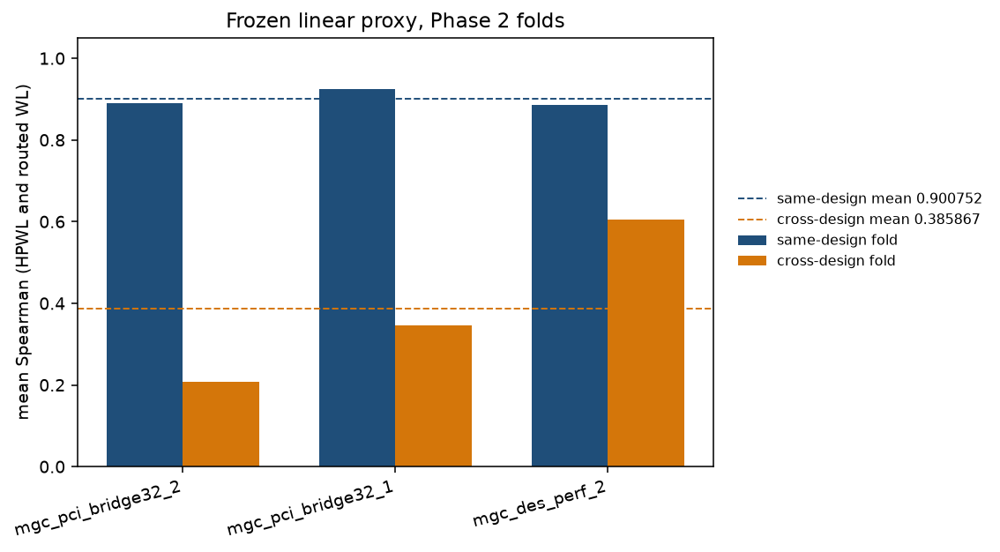
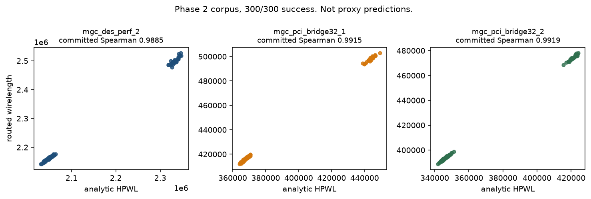
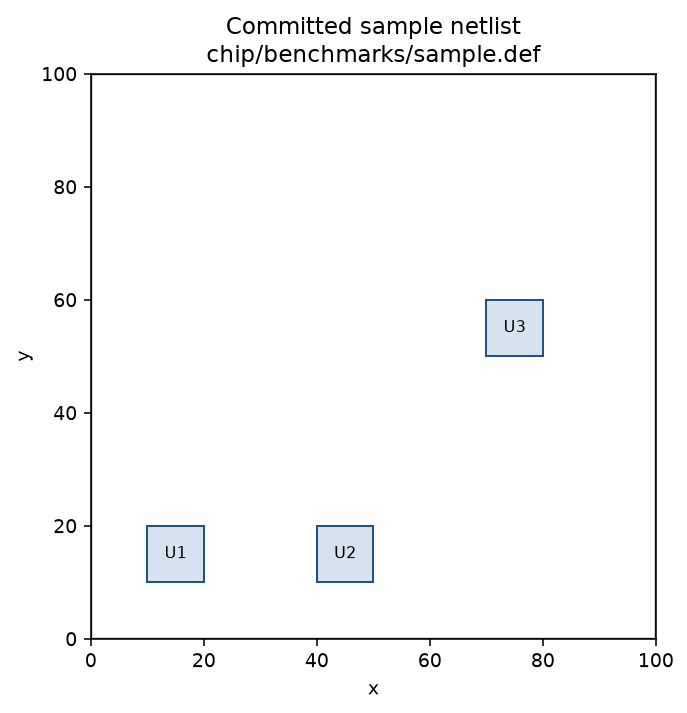
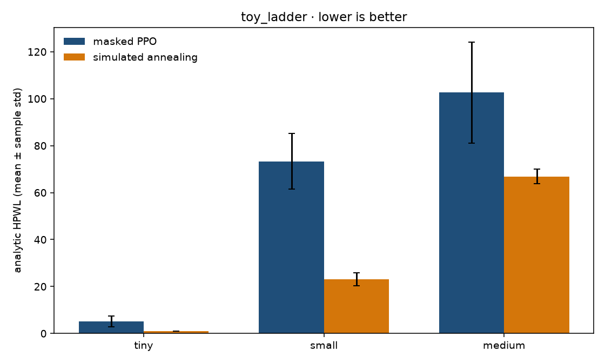
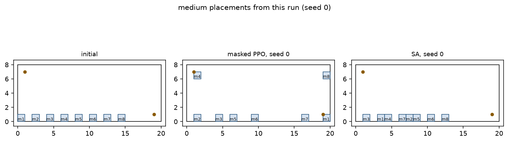
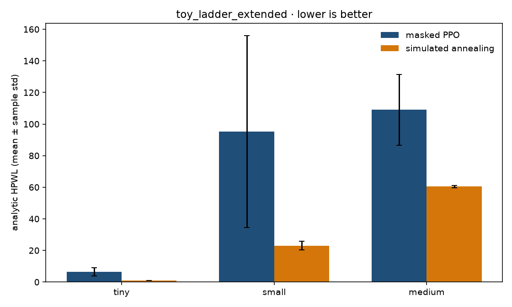
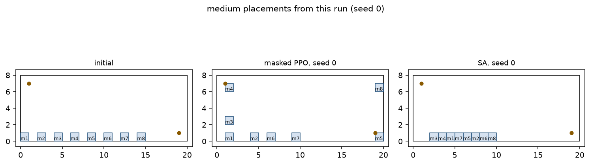

# Graph Placement Engine

Masked PPO and classical search for graph placement, measured on chip netlists with a frozen linear wirelength proxy and an Ariane reference-flow check.

## Headline results

These figures and the table below are read from artifacts already in the repo. They are not the toy-ladder run later in this file.

| Result | Value | Where it is stored | What it is, and what it is not |
| --- | --- | --- | --- |
| Same-design Spearman | **0.9008** | `experiments/chip/phase2_proxy_frozen_base_alpha0_full/phase2_proxy_report.json` field `same_design_mean_spearman` = `0.9007518796992482` | Mean of three same-design folds of the frozen linear proxy (`residual_alpha` 0). The 0.9008 figure is that stored mean rounded to four decimals. Same-design gate at 0.8: pass. |
| Cross-design Spearman | **0.3859** | same file, `cross_design_mean_spearman` = `0.3858668650075853` | Mean of three leave-one-design-out folds, same rounding. Sanity gate (above 0): pass. Stretch gate (0.5): **fail**. |
| Ariane reference-flow DRC | **0** | `experiments/chip/phase3_macroplacement_probe/ariane133_ng45_reference_orfs_completion.json` field `drc_violations` | Reference Ariane floorplan through the OpenROAD-flow-scripts (ORFS) fast completion (`FLOORPLAN_DEF`, `SKIP_CTS_REPAIR_TIMING=1`). Not an RL placement, and not a DRC result for the ISPD acceptance runs. |

Phase 2 corpus, from `experiments/chip/phase2_dataset_full_stratified_main_summary.json`: **300/300** rows succeeded, **0** timeouts, **0** errors. `phase3_foundation_ready` is true. The production proxy path is the frozen linear base. The GNN / MLP line is not that path.

The Ariane generic OpenROAD eval of the reference DEF is `blocked_generic_eval` (return code 1) in `ariane133_ng45_status.json`. The 0 DRC count is the separate ORFS completion. That completion reports WNS `-0.676384` and TNS `-1473.26`, with `timing_gated` false: timing is reported and not used as a gate. `finish_error_count` is 0 and `finish_warning_count` is 3. Runtime is about 70.8 minutes (`runtime_minutes` `70.77376602490743`). The artifact's own note is that this path is offline evaluation only, because that wall time is too high for a PPO inner-loop reward. Macro count in the completion record is 132 and standard-cell count is 187049.

## Figures

Per-fold proxy Spearman. Dashed lines are the stored means `0.9007518796992482` and `0.3858668650075853`, printed with six significant digits.



Analytic HPWL against OpenROAD routed wirelength on the 300-row corpus. This is not a predicted-versus-actual proxy scatter: the committed report does not store per-row proxy outputs. Panel titles round each design's stored `hpwl_vs_routed_spearman` to four decimals.



The only committed placement geometry in-tree is the sample netlist. It is not an optimized result and not Ariane.



Regenerate these three from the committed JSON and `chip/benchmarks/sample.{lef,def}`:

```bash
python scripts/plot_committed_results.py --output-dir docs/figures
```

## Related work in this portfolio

Operations-research companion: [inventory](https://github.com/OrrinChen/inventory).

## Quickstart

Python 3.11 or newer.

```bash
python -m venv .venv
source .venv/bin/activate
python -m pip install -r requirements-dev.txt
python -m pytest tests/engine tests/toys tests/chip/test_cost.py tests/chip/test_constraints.py tests/chip/test_netlist_parser.py tests/chip/test_ppo_vs_sa.py -q
python -m chip.experiments.ppo_vs_sa --config experiments/ppo_vs_sa/configs/smoke.json --output-dir /tmp/ppo-vs-sa-smoke
```

The smoke config is one `tiny` seed and one PPO update. Its standard deviation is undefined. Do not quote it as the comparison result.

OpenROAD, ORFS, Docker, and the ISPD / TILOS MacroPlacement assets are external. They are not installed by `requirements.txt`. Real-chip commands expect them under `tmp/`.

## Masked PPO vs simulated annealing

Both budgets below were run on this machine (Python 3.12.3, torch 2.15.0+cpu, Linux). The metric is analytic HPWL. Lower is better. The spread is the sample standard deviation across seeds 0–4 (`statistics.stdev`, ddof=1). Display strings use Python format `.6g`; full precision is in each `summary.json`. Every seed of both methods was legal (5/5) on tiny, small, and medium.

Masked PPO is `PPOPlacementPolicy` trained from scratch. Illegal grid cells are masked with `-inf`. The reported HPWL is a deterministic argmax rollout after training, not the best stochastic training episode. Simulated annealing uses the Phase 1 neighbor in `chip/experiments/baseline.py`. Its search objective is analytic HPWL plus constraint penalty; the reported score is analytic HPWL of the incumbent. The action spaces differ: PPO places macros one at a time onto a legality mask, and SA perturbs a full placement.

These runs are the in-repo toy ladder (`tiny`, `small`, `medium` in `chip/experiments/phase3_benchmarks.py`). They are not Ariane, not the ISPD `mgc_*` benchmarks, and not routed wirelength.

### toy_ladder

Config `experiments/ppo_vs_sa/configs/toy_ladder.json`: hidden dim 32, 8 PPO updates, learning rate `1e-3`, clip 0.2, gamma 0.99, entropy coef 0.01, value coef 0.5; SA 200 iterations, initial temperature 10, cooling 0.95.

```bash
python -m chip.experiments.ppo_vs_sa --config experiments/ppo_vs_sa/configs/toy_ladder.json --output-dir experiments/ppo_vs_sa/runs/toy_ladder
python scripts/plot_ppo_vs_sa.py --summary experiments/ppo_vs_sa/runs/toy_ladder/summary.json --placements experiments/ppo_vs_sa/runs/toy_ladder/placements.json --output-dir docs/figures/toy_ladder
```

Initial analytic HPWL: tiny 8, small 100, medium 80.5.

| Benchmark | Masked PPO | Simulated annealing | Paired delta (PPO − SA) |
| --- | --- | --- | --- |
| tiny | 5.2 ± 2.28035 | 1 ± 0 | 4.2 ± 2.28035 |
| small | 73.36 ± 11.7392 | 23 ± 2.73861 | 50.36 ± 13.6568 |
| medium | 102.6 ± 21.5389 | 66.9 ± 3.17017 | 35.7 ± 22.1912 |





On medium, masked PPO's mean (102.6) is worse than the initial placement (80.5). SA's mean (66.9) is better than that initial placement.

### toy_ladder_extended

Config `experiments/ppo_vs_sa/configs/toy_ladder_extended.json`: hidden dim 64, 40 PPO updates, same other PPO hyperparameters; SA 2000 iterations, same temperature schedule; the same five seeds.

```bash
python -m chip.experiments.ppo_vs_sa --config experiments/ppo_vs_sa/configs/toy_ladder_extended.json --output-dir experiments/ppo_vs_sa/runs/toy_ladder_extended
python scripts/plot_ppo_vs_sa.py --summary experiments/ppo_vs_sa/runs/toy_ladder_extended/summary.json --placements experiments/ppo_vs_sa/runs/toy_ladder_extended/placements.json --output-dir docs/figures/toy_ladder_extended
```

| Benchmark | Masked PPO | Simulated annealing | Paired delta (PPO − SA) |
| --- | --- | --- | --- |
| tiny | 6.4 ± 2.60768 | 1 ± 0 | 5.4 ± 2.60768 |
| small | 95.32 ± 60.7031 | 23 ± 2.73861 | 72.32 ± 59.7894 |
| medium | 109 ± 22.5333 | 60.5 ± 0.707107 | 48.5 ± 22.4944 |





The longer budget did not lower masked PPO's mean HPWL relative to the 8-update run. Small's PPO standard deviation is large because seed 1's deterministic eval HPWL is 203.2 while the other four seeds are between 56.6 and 73.6.

Wall-clock seconds for training plus eval (PPO) or for the anneal (SA), same mean ± sample-std display, are the `runtime_seconds_display` fields in the two summary files. The first PPO seed is slower than the later seeds.

## Not yet run

Real-chip Ariane masked PPO versus SA has not been run. The runner rejects `ariane133` and writes no metrics:

```bash
python -m chip.experiments.ppo_vs_sa --config experiments/ppo_vs_sa/configs/ariane.json --output-dir experiments/ppo_vs_sa/runs/ariane
```

That command exits 2. It needs `tmp/MacroPlacement` before a real-chip run is possible, and this entrypoint does not call OpenROAD or ORFS.

Phase 1 acceptance and the Phase 2 dataset / proxy fit were not re-executed for this write-up. The commands, for a machine that already has the external benchmarks and OpenROAD, are:

```bash
python -m chip.experiments.phase1_acceptance
python -m chip.experiments.phase2_dataset --help
python -m chip.experiments.phase2_proxy --help
```

## Limitations

- Same-design Spearman is high on three ISPD-style designs. Cross-design Spearman misses the 0.5 stretch gate. That is a proxy-ranking result for HPWL and routed wirelength, not a placement-quality win for PPO.
- The Ariane 0 DRC count is the reference floorplan's fast ORFS completion. Phase 1 acceptance on `mgc_pci_bridge32_1`, `mgc_pci_bridge32_2`, and `mgc_des_perf_2` is a different flow: those rows in `experiments/chip/phase1_acceptance_results.json` are marked `infra_pass / quality_pass` and still report SA DRC counts of 32829, 33544, and 134172 (built-in placer 32545, 33378, and 134512).
- The toy-ladder comparison does not share an action space, does not use a routed or timed reward, and does not transfer to Ariane. A unified RL / SA / analytical / OpenROAD table on three or more real macro-placement benchmarks is still open.
- Benchmark assets and OpenROAD are not vendored. `pyproject.toml` only carries package metadata; install from `requirements.txt` and `requirements-dev.txt`.

## Layout

```text
chip/                 chip constraints, cost, parsers, experiment entrypoints
engine/               graph, SA, analytical solver, masked PPO policy
experiments/chip/     committed phase reports
experiments/ppo_vs_sa configs and the runs reported above
docs/figures/         plots from those artifacts and runs
tests/                engine, chip, and toy tests
```

Further design notes: `graph_placement_engine_roadmap.md`.
License: MIT, copyright Orrin Chen.
